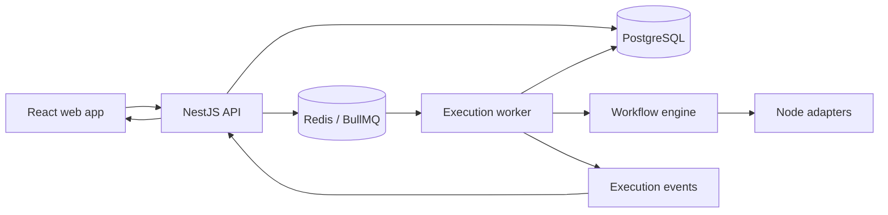

# FlowEngine

[Português (Brasil)](README.pt-BR.md) · [AGPL-3.0-only](LICENSE)

**Build workflows. Connect systems. Automate everything.**

FlowEngine is an open-source workflow automation platform designed around a visual editor, an event-driven execution engine, asynchronous processing and extensible integrations.

> **Status:** Early development. This repository currently contains the design and roadmap; the runtime and visual editor are not implemented yet.

## Product vision

Build reusable automations by connecting triggers, actions and conditions on a visual canvas. Inspect execution results, handle failures and integrate external services without writing a complete application.

## Product model

| Edition | Direction |
| --- | --- |
| Community | Open-source, self-hosted workflow automation |
| Cloud | Planned managed SaaS with subscriptions, backups and operational support |
| Enterprise | Potential negotiated alternative licensing, subject to rights and legal review |

Community is the foundation for the hosted product. Billing, enterprise licensing and hosted services are not available yet. Initial market validation will focus on practical spreadsheet and business-process automations, with synthetic demonstration data.

## Planned capabilities

- Visual workflow editor with typed nodes and edges
- Manual, scheduled and webhook triggers
- HTTP requests, data transformations and conditional routing
- Background execution, bounded retries and execution history
- Organization-scoped workflows and encrypted credentials
- Real-time execution updates and extensible integrations

## Architecture

The diagram describes the target architecture, not deployed services.

| Layer | Planned technologies |
| --- | --- |
| Web | React, TypeScript, React Flow, Tailwind CSS |
| API | NestJS, PostgreSQL, Prisma |
| Execution | TypeScript, Redis, BullMQ |
| Delivery | Docker, GitHub Actions, Railway |
| Quality | Vitest, Playwright, OpenTelemetry |

## Documentation

- [Architecture and execution semantics](docs/architecture.md)
- [Development roadmap](docs/roadmap.md)
- [Security design](docs/security.md)
- [Contributing](CONTRIBUTING.md)
- [Licensing policy](docs/licensing.md)
- [SaaS product strategy](docs/saas.md)

## Getting started

Executable installation instructions will be published once the initial application scaffold is available. No running demo or production readiness is claimed at this stage.

## License

New original project material is licensed under the [GNU Affero General Public License v3.0 only (AGPL-3.0-only)](LICENSE), unless explicitly stated otherwise. Previously granted MIT rights remain in effect for the earlier material; see [legacy notice](LICENSES/MIT-legacy.txt) and [licensing policy](docs/licensing.md). Third-party components retain their own licenses. Copyright (c) 2026 mateusfaria854-bit.
